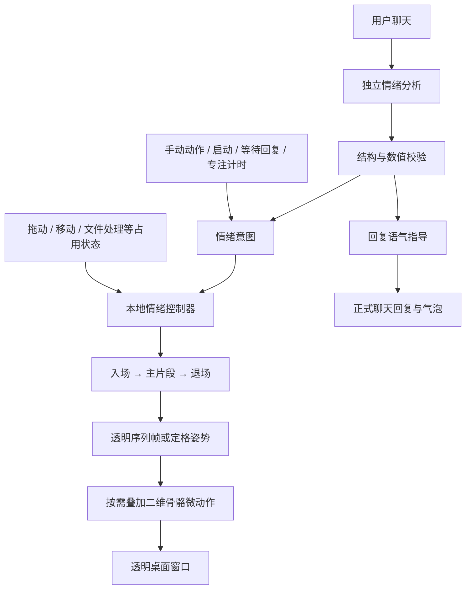

# NaiWaChatPet 非游戏功能与动画架构学习笔记

研究日期：2026-10-28。仓库：[SbongeBobybl/NaiWaChatPet](https://github.com/SbongeBobybl/NaiWaChatPet)。
阅读快照：`008eb12636f517aedecee6f1a1fc773c2f0df6c4`，源码子目录 README 标示 13.4.0。

本笔记来自相关源码、动画清单及整合模块的静态阅读，没有运行对方的应用、构建脚本或联网模型请求。表情数量、调度阈值和缓存行为均按此提交记录，后续上游可能变化。研究期间仅新增本笔记，没有更改本项目运行逻辑。

## 一、最值得借鉴的结论

1. 普通桌宠的立体感主要保留在美术素材里。播放端结合透明 PNG 序列帧、单帧定格姿势和二维骨骼网格变形，无需完整三维角色。
2. 表情、一次回应的情绪判断、动作播放分别管理。模型返回的是情绪意图，能否播放、何时播放和用哪段素材由本地控制。
3. 定格姿势也可以生动：对图片做轻微呼吸、点头、摇摆；换姿势时以短暂压缩和回弹缓和跳变。
4. 在当前 C# / WPF 工程上可以采用相同的职责划分。技术语言没有必要跟着参考项目换成 Go。
5. 资源准备同样关键：统一画布、脚底基线、角色尺寸和嘴部锚点。仅加计时器并不能解决素材切换时的跳位置、跳比例。

## 二、实际技术与调用链

普通桌宠宿主为 Go + Win32 / GDI；整合包的桌面整理是独立 DeskBox 应用，其集成代码为 C# / WinUI。普通二维骨骼模块与战斗专用的技能骨骼资源是不同路径，本研究关注前者。

模型调用和窗口更新分离：聊天任务发布结果，桌宠 tick 通过序号消费情绪结果，再渲染画面。宿主使用单调时钟；动画帧号按已过去时间计算。

源码：[宿主 tick / render](https://github.com/SbongeBobybl/NaiWaChatPet/blob/008eb12636f517aedecee6f1a1fc773c2f0df6c4/Source/NaiWaChatPet/source/cmd/codexpet/host_windows.go#L418)、[桌宠与情绪模块的衔接](https://github.com/SbongeBobybl/NaiWaChatPet/blob/008eb12636f517aedecee6f1a1fc773c2f0df6c4/Source/NaiWaChatPet/source/cmd/codexpet/emotion_windows.go)。

## 三、表情资源怎么管理

### 统一表情目录

`emotion/catalog.go` 里的 Catalog 是统一定义处，条目包括：

- ID、中文名称。
- 是否允许模型自动选择。
- 适用场景 Rule、回复语气 Tone。
- 是否为定格姿势 Posed，绑定哪种微动作 Gesture。
- 是否为有入场/退场的场景 Scene。
- 优先级 Priority。

此快照有 26 种模型可选表情，另有 7 种自用姿势，及 organize 整理场景，共 34 个 Catalog 条目；neutral 是额外的待机标签。分类提示词、标签校验、语气指导、部分菜单和导入工具读取同一目录，减少定义分散。

源码：[表情目录](https://github.com/SbongeBobybl/NaiWaChatPet/blob/008eb12636f517aedecee6f1a1fc773c2f0df6c4/Source/NaiWaChatPet/source/emotion/catalog.go)。

### 每个片段有独立清单

`animations/<名称>/manifest.json` 记录帧率、帧数、循环、优先级、入场/退场片段、画布、脚底基线、嘴部锚点或锚点关键帧、帧文件及哈希、资源审核标记。

已核对的实际例子：

| 片段 | 资源形式 | 播放配置 |
|---|---|---|
| shy | 95 张主序列帧 | 30 FPS，非循环，关联 shy_in / shy_out |
| love | 一张定格图 | 清单为 12 FPS 循环，微动作另外由骨骼产生 |
| organize | 52 张主序列帧 | 20 FPS 循环，关联 organize_in / organize_out，优先级 45 |

普通画布为 420 × 560，脚底基线为 540。基线和嘴部锚点让角色及聊天气泡在换姿势后仍能对齐。

加载器检查清单字段、画布、帧数、透明通道、文件路径和 SHA-256；缺少过渡资源时剔除相应片段并报告问题。编码资源总预算 128 MiB，单片段预算 64 MiB；解码帧缓存容量为 8。该缓存按加入顺序淘汰，不能称为完整 LRU。

源码：[资源清单和加载器](https://github.com/SbongeBobybl/NaiWaChatPet/blob/008eb12636f517aedecee6f1a1fc773c2f0df6c4/Source/NaiWaChatPet/source/emotion/library.go)。
实际清单：[shy](https://github.com/SbongeBobybl/NaiWaChatPet/blob/008eb12636f517aedecee6f1a1fc773c2f0df6c4/Source/NaiWaChatPet/animations/shy/manifest.json)、[love](https://github.com/SbongeBobybl/NaiWaChatPet/blob/008eb12636f517aedecee6f1a1fc773c2f0df6c4/Source/NaiWaChatPet/animations/love/manifest.json)、[organize](https://github.com/SbongeBobybl/NaiWaChatPet/blob/008eb12636f517aedecee6f1a1fc773c2f0df6c4/Source/NaiWaChatPet/animations/organize/manifest.json)。

### 定格素材的准备流程

`cmd/import-emotions` 从 GIF 里挑停留最久的非中性姿势，时长相同时选与中性图差异更大的帧；然后去背景/地面、缓解色带、匹配颜色，并按脚的位置对齐。输出单帧资源，运行时补微动作。它没有直接把每个 GIF 完整播放一遍。

源码：[表情导入流程](https://github.com/SbongeBobybl/NaiWaChatPet/blob/008eb12636f517aedecee6f1a1fc773c2f0df6c4/Source/NaiWaChatPet/source/cmd/import-emotions/main.go#L353)。

## 四、情绪怎么判断

正式聊天主链调用 `ClassifyPetEmotion`，先做一次独立的小型非流式模型请求，再生成正式回复。输出恰好四项：`emotion`、`intensity`、`confidence`、`duration_ms`。

- 分析的是奶蛙适合如何回应，提示词要求结合人格和上下文，不机械复制用户的情绪。
- 上下文最多取最近 6 条文字消息，每条截断到 600 字符；截图不进入此分类请求。
- 分类默认超时 4 秒、只尝试一次，最多 256 tokens。
- 严格检查 JSON、重复/未知字段、标签范围、强度、置信度和时长。
- 最低置信度 0.72；分析失败或低置信度返回 neutral，正式聊天继续。
- request ID 与 generation 防止过期任务覆盖新任务。
- 分类结果同时生成正式回复的语气指导；内部标签和 JSON 不显示到聊天气泡。

这里管理的主要是一次回应的表情意图及其强弱和持续时长。在已读主链中，没有看到独立的长期心情、饥饿、亲密度等持续数值模型，不能把此控制器直接等同于完整养成系统。

仓库中还有旧的关键词语义函数及 demo 逻辑；正式聊天的独立分类入口应与这些路径区分。

源码：[分类协议](https://github.com/SbongeBobybl/NaiWaChatPet/blob/008eb12636f517aedecee6f1a1fc773c2f0df6c4/Source/NaiWaChatPet/source/emotion/analysis.go)、[分类请求与提示词](https://github.com/SbongeBobybl/NaiWaChatPet/blob/008eb12636f517aedecee6f1a1fc773c2f0df6c4/Source/NaiWaChatPet/source/companion/emotion_analysis.go)、[正式回复生成](https://github.com/SbongeBobybl/NaiWaChatPet/blob/008eb12636f517aedecee6f1a1fc773c2f0df6c4/Source/NaiWaChatPet/source/companion/conversation.go#L242)。

## 五、动作如何排队与切换

控制器持有 current 和 pending。pending 是一个等待槽，新请求可以替换此前等待项，并非无限动作队列。

### 调度规则

- 相同 request ID 不重复执行，保留最近 64 个 ID。
- 相同情绪合并而不从头播放，强度按旧值 65% + 新值 35% 平滑。
- 新情绪有惯性，已播放动作至少保持一定时间，再在合适阶段退场。
- 普通情绪冷却 6 秒，强烈 happy 冷却 20 秒；手动动作绕过此冷却。
- 强度不足 0.18 倾向回待机；happy 的 0.18–0.6 区间会在素材可用时转为 smile，达到 0.6 才能走完整大笑路径。
- 拖动、按住、移动、消化/基础动作占用期间阻塞情绪片段，过期 pending 不再播放。
- 用 in / main / out 阶段组织入场、主动作与退场。
- smooth 请求有衰减；自然完成后返回 neutral / 待机。
- organize 优先级高于普通表情，整理任务还会主动中断现有表情。
- 情绪保护期间，鼠标悬停触发的基础出拳不应抢占。

基础 `animation.Engine` 另外负责待机、大笑、进食、转身和后续道具等状态，具有不可抢占的原子动作段。它按时间推进，即使错过多帧，也处理跨过的事件节点，不依赖“每次 tick 帧号加一”。

源码：[情绪调度](https://github.com/SbongeBobybl/NaiWaChatPet/blob/008eb12636f517aedecee6f1a1fc773c2f0df6c4/Source/NaiWaChatPet/source/emotion/scheduling.go)、[控制器与阶段推进](https://github.com/SbongeBobybl/NaiWaChatPet/blob/008eb12636f517aedecee6f1a1fc773c2f0df6c4/Source/NaiWaChatPet/source/emotion/controller.go)、[基础动作状态机](https://github.com/SbongeBobybl/NaiWaChatPet/blob/008eb12636f517aedecee6f1a1fc773c2f0df6c4/Source/NaiWaChatPet/source/animation/engine.go)。

## 六、2D 骨骼和微动作

`rig` 把原图片映射到三角网格，通过骨骼的二维仿射变换和顶点权重弯曲网格，再将原纹理栅格化输出。顶点最多由 4 根骨骼加权影响。

有用于走动的 Stand、基础出掌姿势的 Stance，以及定格表情的 Figure。Figure 主要有根、脊柱、头部三根骨骼；GesturePose 定义呼吸、点头、摇头、摇摆、弹跳、颤抖、叹气、鞠躬、歪头等小循环。

换定格图时约用 70 ms 下蹲压缩，再用约 220 ms 回弹衔接。普通走动在待机帧上继续叠加骨骼，因此原本呼吸可以保留。整理搬箱时，箱子锚点跟随身体骨骼。

这些是二维图像网格变形。战斗技能的专用骨骼资源不应与普通 Figure/Stand 机制混为一谈。

源码：[二维骨骼与加权栅格化](https://github.com/SbongeBobybl/NaiWaChatPet/blob/008eb12636f517aedecee6f1a1fc773c2f0df6c4/Source/NaiWaChatPet/source/rig/rig.go)、[骨架定义](https://github.com/SbongeBobybl/NaiWaChatPet/blob/008eb12636f517aedecee6f1a1fc773c2f0df6c4/Source/NaiWaChatPet/source/rig/puppets.go)、[动作曲线](https://github.com/SbongeBobybl/NaiWaChatPet/blob/008eb12636f517aedecee6f1a1fc773c2f0df6c4/Source/NaiWaChatPet/source/rig/motion.go)、[姿势切换与渲染](https://github.com/SbongeBobybl/NaiWaChatPet/blob/008eb12636f517aedecee6f1a1fc773c2f0df6c4/Source/NaiWaChatPet/source/cmd/codexpet/play_windows.go#L1013)。

## 七、其他非游戏功能

| 功能 | 实现要点 | 主要入口 |
|---|---|---|
| 拖动、点击、右键、调整大小 | Win32 消息；点击/拖动判定；按当前透明图做命中测试；DPI 变化时重算尺寸 | host_windows.go、interaction/gesture.go |
| 透明显示与资源管理 | 合成角色/道具/阴影，预乘 Alpha 的 BGRA，UpdateLayeredWindow；渲染键未变就跳过重绘与重复呈现 | compositor、winlayer、host.render |
| 桌面聊天输入和回复气泡 | 原生窗口；多行输入；流式正文；长回复展开与滚动；按嘴部锚点选择气泡位置 | chat_windows.go、desktopchat/layout.go |
| 模型连接 | 可配置兼容服务地址与模型；SSE；取消、重试、超时；部分正文已产生时避免自动重复请求 | companion/client.go、conversation.go、models.go |
| 设置界面 | 监听 127.0.0.1 随机端口的本地网页；会话 token、Host / Origin 校验；个性与参数持久化 | companion/server.go、web/index.html |
| 本地记忆 | 只提交完整成功的问答；有界历史；Windows 当前用户 DPAPI 加密保存 Key 和记忆 | companion/storage*.go |
| 主动陪伴 | 间隔、免打扰、每小时上限、输入/回复/阅读占用检查；结合最近对话与主动发言生成内容 | companionship/scheduler.go、companion/proactive_model.go |
| 屏幕感知 | 可选范围、预览与发送；授权及应用排除；模式变更重新授权；暂停/取消使旧任务失效 | companion/observe.go、v13.go、v13_settings.go |
| 日常行为 | 启动问候、等待回复时思索、来回拖动后晕乎、深夜长时间无互动时困倦、专注开始/完成动作 | play_windows.go 的 stepHabits、shaken、dropped |
| 鼠标旁召唤与散步 | 目标点受工作区约束；先中断表情，再发起移动；到达后衔接动作 | play_windows.go |
| 专注计时 | 25 分钟计时和到期提醒，绑定 focused / celebrate | playCommand、stepHabits |
| 桌面整理 | 独立 DeskBox 进程；预览分类、原位置引用/快捷方式/移动；可选 AI 细化；执行记录与撤销 | DeskBox 集成及 aiorganization |
| 文件拖入接收 | 后台 transfer worker 真实转移文件，确认目标后才触发进食等反馈；长度/哈希验证，不覆盖同名目标 | workers.go、safestore/transfer.go |
| 多实例接触反馈 | 通过本地心跳交换窗口矩形，接触检测触发动作；这与局域网对战协议不同 | workers.peerLoop、host.tick |
| 托盘、快捷方式、诊断 | 托盘生命周期、桌面快捷方式、日志、独立情绪调试面板与恢复出厂 | tray、shortcut、emotion_debug、factory_reset |

其中 `play_windows.go` 同时承载普通桌宠行为与游戏相关逻辑，不能仅按文件名把整份文件视作游戏。

聊天上下文与本地记忆的上限不同：发送模型的历史通常限制为 24 条消息/16000 字符，磁盘记忆限制为 200 条消息/128000 字符。应把它理解为有界历史，不是语义检索式的长期记忆系统。

屏幕感知重启后恢复为关闭，付费主动观察授权也不直接恢复。手动预览和获授权的定时观察是不同路径，不能把全部模式描述为“每次必定手动确认后才能发送”。

音频代码中核对到动作绑定 PCM 和随大笑状态启停的机制；不能据此推断已实现通用聊天 TTS。

源码：[聊天气泡](https://github.com/SbongeBobybl/NaiWaChatPet/blob/008eb12636f517aedecee6f1a1fc773c2f0df6c4/Source/NaiWaChatPet/source/cmd/codexpet/chat_windows.go)、[模型客户端](https://github.com/SbongeBobybl/NaiWaChatPet/blob/008eb12636f517aedecee6f1a1fc773c2f0df6c4/Source/NaiWaChatPet/source/companion/client.go)、[记忆](https://github.com/SbongeBobybl/NaiWaChatPet/blob/008eb12636f517aedecee6f1a1fc773c2f0df6c4/Source/NaiWaChatPet/source/companion/storage.go)、[主动陪伴调度](https://github.com/SbongeBobybl/NaiWaChatPet/blob/008eb12636f517aedecee6f1a1fc773c2f0df6c4/Source/NaiWaChatPet/source/companionship/scheduler.go)、[屏幕感知](https://github.com/SbongeBobybl/NaiWaChatPet/blob/008eb12636f517aedecee6f1a1fc773c2f0df6c4/Source/NaiWaChatPet/source/companion/observe.go)、[设置恢复](https://github.com/SbongeBobybl/NaiWaChatPet/blob/008eb12636f517aedecee6f1a1fc773c2f0df6c4/Source/NaiWaChatPet/source/companion/v13_settings.go)、[文件转移](https://github.com/SbongeBobybl/NaiWaChatPet/blob/008eb12636f517aedecee6f1a1fc773c2f0df6c4/Source/NaiWaChatPet/source/safestore/transfer.go)。

## 八、桌面整理与动作协作的关键

当前普通整理入口实际打开随包的 `Organizer/DeskBox.exe --ai-organize`；仓库同时保留较早的本地整理模块，不能仅看 tidy 目录就判断当前主入口。

Go 侧通过受当前用户保护的命名管道提供 AI 与动作服务；校验客户端用户/会话身份及 token。AI 分类使用名称等元数据，给出分类建议和受限意图，不执行任意模型命令，也不把聊天记忆交给整理任务。

搬运动画由 C# 的 NaiWaCarryCoordinator 与 Go 的桌宠联动：

1. 整理模块提交本次搬运请求，奶蛙移动到目标。
2. 奶蛙通过到达回执告诉整理模块可以继续。
3. 整理模块执行文件提交，再发送成功/失败回执。
4. 奶蛙根据结果收尾；取消、超时和陈旧回执分别处理。

动画可选完整、简易、无动画；动画预算按每次整理创建，避免一次任务的状态污染下次任务。这里值得借鉴的是业务结果与动画进度协作的方式，不能用“动画播完”等同“文件操作成功”。

源码：[当前整理入口](https://github.com/SbongeBobybl/NaiWaChatPet/blob/008eb12636f517aedecee6f1a1fc773c2f0df6c4/Source/NaiWaChatPet/source/cmd/codexpet/deskbox_lifecycle_windows.go)、[命名管道服务](https://github.com/SbongeBobybl/NaiWaChatPet/blob/008eb12636f517aedecee6f1a1fc773c2f0df6c4/Source/NaiWaChatPet/source/aiorganization/server_windows.go)、[搬运回执处理](https://github.com/SbongeBobybl/NaiWaChatPet/blob/008eb12636f517aedecee6f1a1fc773c2f0df6c4/Source/NaiWaChatPet/source/cmd/codexpet/deskbox_carry_windows.go)、[C# 搬运协调器](https://github.com/SbongeBobybl/NaiWaChatPet/blob/008eb12636f517aedecee6f1a1fc773c2f0df6c4/Source/DeskBox-1.5.8/src/DeskBox/Services/NaiWaCarryCoordinator.cs)、[每次任务的动画策略](https://github.com/SbongeBobybl/NaiWaChatPet/blob/008eb12636f517aedecee6f1a1fc773c2f0df6c4/Source/DeskBox-1.5.8/src/DeskBox/Services/NaiWaAnimationPolicy.cs)。

## 九、适合本项目的后续拆分建议

以下是基于源码的设计建议，还没有实现为本项目功能：

| 职责 | 建议组件 | 初期范围 |
|---|---|---|
| 素材与清单 | AnimationLibrary / AnimationClip | 统一画布、脚底/嘴部锚点、帧时长、循环、过渡；现有 PNG 为 idle 兜底 |
| 帧与过渡播放 | AnimationPlayer | Stopwatch 单调计时；仅活跃动画刷新；冻结并复用 BitmapSource |
| 行为协调 | PetBehaviorController | 拖动/移动/菜单/表情等互斥与可打断策略 |
| 情绪意图调度 | EmotionController | 名称、强度、来源、时长、优先级、冷却、合并、单个待处理意图 |
| AI 与聊天 | ChatService / EmotionAnalyzer | 异步任务；取消与序号；独立失败降级；界面只消费结果 |
| 日常主动行为 | CompanionScheduler | 空闲判定、免打扰、频率上限、专注计时 |
| 设置与保存 | SettingsService | 参数校验、窗口复用、配置保存、凭据保护 |

建议先做好素材规范和动画播放器，再加状态调度与少量日常行为，然后按用户指示逐步接聊天、情绪分析和记忆等功能。桌面整理可以独立设计，避免与基本显示/动作层紧耦合。

整图的 WPF 缩放/平移适合做呼吸和小幅摇摆；独立点头和四肢弯曲需要分层素材或二维网格蒙皮，单个整图变换无法替代这些局部动作。现有一张站立图足够搭调度框架，但还需要一致的表情/动作素材，才能可靠表现完整的大笑、哭泣、转身等变化。

当前“右键 → 设置 / 退出”保持原样。此文档作为后续补功能时的参考，不代表把上表功能一次性加入。

